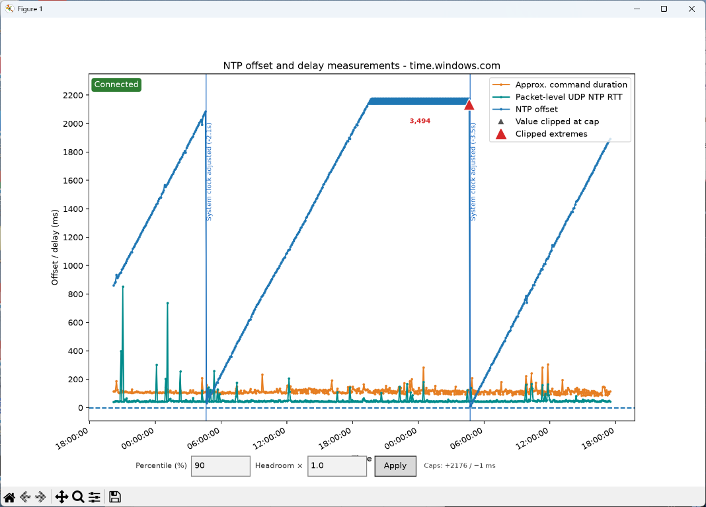

# NTP Plotter

A small Windows desktop tool that samples an NTP server and plots clock offset,
measurement duration, and packet round-trip time over time.



## Requirements

- Windows (the clock-offset measurement uses the built-in `w32tm` command)
- Python 3
- Matplotlib
- Network access to the configured NTP server:
  - `w32tm` must be able to query the server.
  - UDP traffic to port 123 must be allowed for the packet-level RTT measurement.

## Setup

In PowerShell, install Matplotlib:

```powershell
py -m pip install matplotlib
```

If the `py` launcher is not available, use `python` in its place.

## Run

From the project directory:

```powershell
py .\NTP_plotter.py
```

The plot window updates as samples arrive. Close the window to stop sampling.
Measurements and connection errors are also printed to the console. The program
does not currently save or export samples.

## Plot and sampling

The plot shows:

- **NTP offset** — the server-reported clock offset, in milliseconds.
- **Approx. command duration** — how long the `w32tm` offset query took.
- **Packet-level UDP NTP RTT** — the elapsed time for a direct NTP request and
  reply over UDP.
- **Connection failures and events** — failed offset samples, reconnections,
  and detected local system clock adjustments.

Sampling starts every 2 seconds and gradually slows during long runs:

| Elapsed time | Sampling interval |
| --- | --- |
| First 10 minutes | 2 seconds |
| 10–30 minutes | 5 seconds |
| 30–60 minutes | 10 seconds |
| 1–3 hours | 30 seconds |
| 3–12 hours | 1 minute |
| 12–24 hours | 2 minutes |
| After 24 hours | 5 minutes |

Large values are clipped in the display so typical variation remains legible;
triangle markers and labels indicate clipped values. Use the **Percentile (%)**
and **Headroom ×** fields at the bottom of the window and click **Apply** to
adjust the display caps. The percentile must be greater than 0 and at most 100;
headroom must be greater than 0. This affects display scaling only, not the
underlying samples.

## Configure the NTP server

Edit `NTP_SERVER` near the top of `NTP_plotter.py` to use a different server.
The same server is used for both the `w32tm` offset query and the UDP RTT
measurement.
